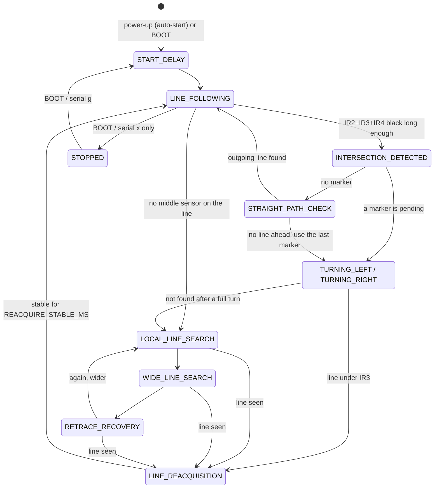

# line-follower-robot

ESP32 line follower for **MECC 2026** (5 digital IR sensors, 2 DC motors on a dual H-bridge). It follows the black line with a PD controller, reads
the small directional boxes beside the line, turns at the thick intersection boxes as the latest box says, goes straight when there is no box,
and never gives up when it loses the line.

> **Read this before the first upload.** With the default settings the robot **starts driving by itself 3 s after power-up or upload**
> (`AUTO_START_ON_BOOT`, the competition setting). For bench testing set `AUTO_START_ON_BOOT` to `false` in
> [`config.h`](line_follower_robot/config.h), or put the robot on a stand with the wheels in the air. The BOOT button, or `x` on the serial monitor,
> stops the motors at any time.

## What has and has not been verified

| | Status |
|---|---|
| Compiles for **ESP32 Dev Module**, Arduino-ESP32 core **3.3.12**, all warnings on | yes, no warnings (291 KB, 22 % of flash) |
| Logic (markers, intersections, straight test, turns, recovery, stop / start, reset handling) | yes, with the real firmware sources driven by a host simulator on this arena (see [Tests](#tests)) |
| Behaviour on the **real robot and arena** | **not tested.** No hardware was available. All timings, speeds and gains are starting guesses |
| Sensor polarity, left / right sensor order, motor directions | **unverified**, they must be checked with the steps below. Sources disagree (see [Hardware assumptions](#hardware-assumptions)) |

## Hardware assumptions

Nothing below is invented hardware: it is what the MECC handout, your wiring table and the earlier sketches say. Each item is a setting in `config.h`.

* **Board**: ESP32 Dev Module (ESP32-WROOM-32), Arduino-ESP32 core **3.x** (the PWM calls are `ledcAttach` / `ledcWrite`).
* **Motor driver**: dual H-bridge (L298N style): two direction pins and one PWM enable pin per motor. **Motor A = the robot's left wheel**, **Motor B = the right wheel**, as in the handout.
  The right motor is mounted the other way round, so its direction pattern is mirrored (`MOTOR_B_INVERT = true`).
* **Sensors**: 5 digital IR modules on GPIO 23, 22, 21, 19, 18. **No encoders, no gyroscope.**

| Logical bit | 0 | 1 | 2 | 3 | 4 |
|---|---|---|---|---|---|
| Sensor | IR1 | IR2 | IR3 | IR4 | IR5 |
| Position | leftmost | middle-left | centre | middle-right | rightmost |
| Job | LEFT marker box | line | **line (the one that stays on it)** | line | RIGHT marker box |
| GPIO | 23 | 22 | 21 | 19 | 18 |

| Function | ESP32 GPIO |
|---|---|
| Motor A direction IN1 / IN2 | 27 / 26 |
| Motor B direction IN3 / IN4 | 13 / 25 |
| Motor A PWM ENA / Motor B PWM ENB | 14 / 33 |
| BOOT button (start / stop) | 0 |

Two places where the sources disagree. **Check both on your robot before trusting either**:

1. **Black = HIGH or LOW?** The handout says the modules are active-low on *reflection*: white drives DO to 0, black leaves DO floating and
   `INPUT_PULLUP` reads **1**, so black = HIGH (`SENSOR_BLACK_LEVEL = HIGH`, the default here). The earlier `FastLineFollower` sketch assumed black = LOW.
2. **Which end is IR1?** The handout calls GPIO 18..23 "IR_1..IR_5"; your wiring table and the earlier sketches put the *left* sensor on GPIO 23.
   This program uses your table (`IR_GPIO[] = {23, 22, 21, 19, 18}`, left to right). If the sensor test shows them reversed, reverse that array.

## Build and upload

Arduino IDE 2.x: *Boards Manager* → **esp32 by Espressif Systems** (3.x, not "Arduino ESP32 Boards") → *Tools → Board → ESP32 Dev Module* →
open `line_follower_robot/line_follower_robot.ino` → Upload. Serial monitor **115200 baud**. Or with the CLI:

```bash
arduino-cli compile --fqbn esp32:esp32:esp32 --warnings all line_follower_robot
```

## First-run checklist (in this order)

1. **Bench mode.** Set `AUTO_START_ON_BOOT false`, upload, lift the robot. The log prints the reset reason and the wiring it assumes.
2. **Sensors.** Serial `m` prints `SENSORS IR1..IR5 = 0 1 0 0 0` ten times a second. Slide a black strip under the sensors from left to right: the `1` must move
   from the first digit to the last, and only the sensor over black may be `1`. Inverted bits: flip `SENSOR_BLACK_LEVEL`. Reversed order: reverse `IR_GPIO[]`.
   Set each module's potentiometer so it separates black from the arena floor at the mounting height.
3. **Wheels.** Serial `w` (robot lifted, stopped) runs eight movements, one second each, and prints what to expect: left only, right only, forward, backward,
   pivot left (anticlockwise seen from above), pivot right, curve left, curve right. A wheel going the wrong way: flip that channel's `MOTOR_x_INVERT`.
   Robot drifting to one side on a straight: trim `LEFT_PWM_SCALE` / `RIGHT_PWM_SCALE`. Wheels hum but do not turn at low speed: raise `MIN_MOVE_PWM`.
4. **Line following.** Put it on a straight line at low speed (`BASE_SPEED` about 120). Weaves: lower `PD_KP`, raise `PD_KD`. Cuts corners: the opposite.
5. **Intersection confirm time.** Drive round the arena and read the lines `THICK run ended after N ms`. Boxes give long runs, bends give short ones.
   Set `INTERSECTION_CONFIRM_MS` between the longest bend and the shortest box.
6. **Advance and pivot.** `INTERSECTION_ADVANCE_MS` puts the wheel axle over the middle of the box before a marker turn; `TURN_BLIND_MS` must clear the straight branch
   but stay shorter than the time to the nearest 45-degree line. These are timed approximations, not angles, and they change with the battery.
7. **Competition mode.** Set `AUTO_START_ON_BOOT true` again.

## How it behaves



* **Never stops by itself.** `STOPPED` is entered only by BOOT, serial `x`, or bench mode at power-up, and `FINISHED` only if you enable it (below). A lost line, a strange
  sensor pattern, a failed turn or an exhausted search only ever leads to another moving strategy. While stopped the loop still reads sensors and logs.
* **Line following.** Error mapping for IR2 IR3 IR4: `100` = -1, `110` = -0.5, `010` = 0, `011` = +0.5, `001` = +1 (negative = line on the left = steer left).
  `101` keeps the last error. `steer = PD_KP*error + PD_KD*(error change over DERIVATIVE_WINDOW_MS)`, left wheel `speed + steer`, right wheel `speed - steer`.
* **Markers (IR1 / IR5).** One box = one event, committed when the box has passed (black `MARKER_CONFIRM_MS..MARKER_MAX_MS`, then white `MARKER_RELEASE_MS`). A line that
  runs into an intersection stays black into the thick box and is therefore never counted. Ignored in every state except `LINE_FOLLOWING`, and while IR2+IR3+IR4 are all black.
  * single marker: `pendingTurn` = its side **and** `lastValidMarkerDirection` = its side; the latest marker overrides earlier ones
  * both sides at once: `pendingTurn = NONE`, `lastValidMarkerDirection` is **left unchanged** (set `DOUBLE_MARKER_CLEARS_HISTORY` to change that)
  * `pendingTurn` is consumed when the turn **completes**, not when the intersection is entered; `lastValidMarkerDirection` is never consumed; `lastLineErrorSide` is separate
* **Intersection.** All three middle sensors black for `INTERSECTION_CONFIRM_MS`; each box once; re-armed after the middle sensors have been not-all-black for
  `INTERSECTION_REARM_CLEAR_MS` and `INTERSECTION_REARM_HOLDOFF_MS` has passed.
* **No marker: straight first.** Drive over the box (phase CLEAR: at least `STRAIGHT_CLEAR_MS` and until the middle sensors leave the box), then look for a line for
  `STRAIGHT_PROBE_MS` (PROBE: `100`, `110`, `010`, `011` or `001` stable for `STRAIGHT_STABLE_MS`). Only if no line appears in the whole probe window is straight
  "not available"; one missing reading proves nothing, and the line-lost handler is not active during the test. Not available: turn the way of
  `lastValidMarkerDirection` (default `LEFT` if none), after reversing back to the box centre.
* **Turning (timed pivot + sensors).** reposition → blind pivot `TURN_BLIND_MS` → pivot until IR3 is on a line (never the thick box) and the sensors have seen "no line"
  since the pivot began → `LINE_REACQUISITION` (creep until the pattern is stable) → `LINE_FOLLOWING`. If no line turns up for `TURN_SEEK_PATIENCE_MS` the robot hands over to the search.
* **Recovery.** `LOCAL` (pivot sweeps toward `lastLineErrorSide`) → `WIDE` (growing arcs with a little reverse) → `RETRACE` (reverse, then wide sweeps first toward the last
  turn) → `LOCAL` again, longer and starting on the other side, for ever. The retrace is **approximate**: without encoders or a gyro the robot cannot know its path.
* **Resets.** The reset reason is printed at boot. After an *unexpected* reset (panic, watchdog, brownout) the marker memory is restored from RTC memory and a run that was active resumes
  after `AUTO_RESTART_DELAY_MS` without BOOT. A deliberate stop stays stopped. Software cannot survive a real power loss or a hardware fault.
  (Exercised in the simulator with the reset reason faked; that RTC memory really survives a brownout on your board is not verified.)
  The L298N plus motors can sag the supply on a hard reversal (`MOTOR_SLEW_PWM_PER_MS` ramps through zero to soften that), but a weak supply is a hardware fix.

### The finish box (not in the original specification)

The finish is a black area much bigger than an intersection box. Your rules say the robot must never stop by itself, so by default (`FINISH_STOP_ENABLED false`) the oversized area is logged
and treated like any other "no straight line", and the robot keeps driving and searching. Set `FINISH_STOP_ENABLED` to `true` if the competition requires stopping inside the box: it then stops
its motors in `FINISHED`, keeps logging, and resumes by itself when the sensors leave all-black for `FINISH_RESUME_MS` (it does not wait for BOOT).

## Arena

The robot starts on the START line heading north with IR3 on the line. Letters name the thick boxes; `I` is the cross on the START line.

| # | Box | Arrive heading | Marker before it | Action | Straight branch exists? |
|---|---|---|---|---|---|
| 1 | I | N | LEFT | turn LEFT | yes (dead-end stub) |
| 2 | H | W | RIGHT | turn RIGHT (about 45°) | no |
| 3 | G | NW | RIGHT | turn RIGHT (about 45°) | no |
| 4 | F | N | RIGHT | turn RIGHT | no |
| 5 | E | E | RIGHT | turn RIGHT (about 45°) | no |
| 6 | J | S | LEFT | turn LEFT | yes (loop) |
| 7 | **K** | E | **none** | straight test **fails** → last valid marker (LEFT) → turn **LEFT** | **no** |
| 8 | L | N | LEFT | turn LEFT (about 45°) | yes |
| 9 | **D** | W | **none** | straight test **succeeds** → go straight | yes |
| 10 | C | W | RIGHT | turn RIGHT (about 135°) | yes |
| 11 | A | NE | RIGHT | turn RIGHT (about 45°) | no |
| 12 | **B** | E | **none** | straight test **succeeds** → into the FINISH box | yes |

The three sections without a marker are #7, #9 and #12. One program condition covers them: `pendingTurn == NONE` **and** the straight-path test found no line → turn
`lastValidMarkerDirection`. At #9 and #12 the test finds a line, at #7 it does not, which gives the required left turn. No colour or picture is used by the code.

## Serial console (115200 baud)

`g` start · `x` stop the motors · `w` wheel test (only when stopped) · `m` sensor monitor on / off · `?` help and status.
Every state change is logged (`STATE A -> B | sensors=01110 pending=LEFT lastMarker=LEFT`) together with each marker, intersection (`DECISION #n ...`), search stage and
reset; `STATUS` lines every 500 ms show state, sensors, memory and wheel commands, so a stopped robot can be told apart from a reset one (`Reset reason: BROWNOUT ...  <-- UNEXPECTED`).

## Tests

The real firmware sources are compiled against a mock of the Arduino core and driven by a simulated differential-drive robot on this arena. The simulator has its **own** idea of the
wiring (from the handout), so a wrong pin, polarity, side or inversion in the firmware makes the simulated robot drive wrongly.

```bash
./test/run_tests.sh                                              # everything (needs g++, clang++ or Zig; "pip install ziglang" works)
EXTRA_FLAGS="-DFINISH_STOP_ENABLED=true" ./test/run_tests.sh arena finish_stop
EXTRA_FLAGS="-DAUTO_START_ON_BOOT=false" ./test/run_tests.sh bench_mode
```

Covered: marker rules (one box = one event, double marker, release, suppression, a line running into a box), navigation memory and the fallback rule, every movement function against the
wiring, PD signs, 180 s of "no line" / all-black / random noise with the wheels never commanded off for more than a few ms, BOOT and serial stop / start, the wheel test, unexpected-reset handling,
the full arena run (all 12 decisions, finish reached), a robot dropped crooked beside the line, and an 18-variant robustness sweep (speed, sensor geometry, motor lag, dead zone, track width, marker placement).

The simulator's speeds, sensor geometry, line / box sizes and motor model are **plausible guesses**. A pass shows the logic works, not that the tuning suits the real robot. It does not model wheel slip,
battery sag, sensor noise or lighting. Sharp track bends are a known weak spot: the bar can cross a bend as a short all-black run (30-46 ms in the simulator, boxes 210-270 ms), and the robot sometimes overshoots one
and recovers through the search (one such recovery per lap in the simulator).

## Layout

| Path | Purpose |
|---|---|
| `line_follower_robot/` | the Arduino sketch: `config.h` (all calibration), `sensors.*`, `motor.*` (workshop API kept), `navigation.*`, `robot.*` (state machine), `diagnostics.*` |
| `test/` | host tests: `run_tests.sh`, `test_main.cpp`, `sim.h` (arena + robot simulator), `mock/` (Arduino core stand-in) |
